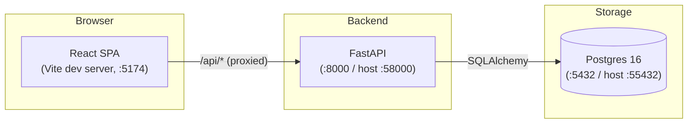
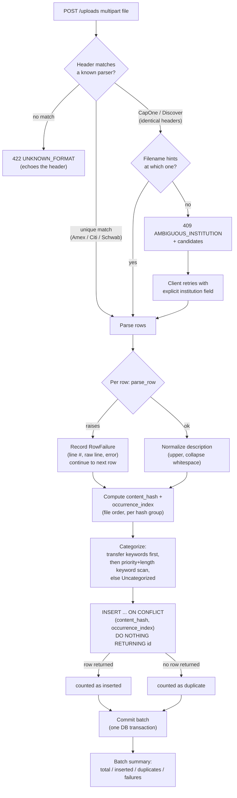
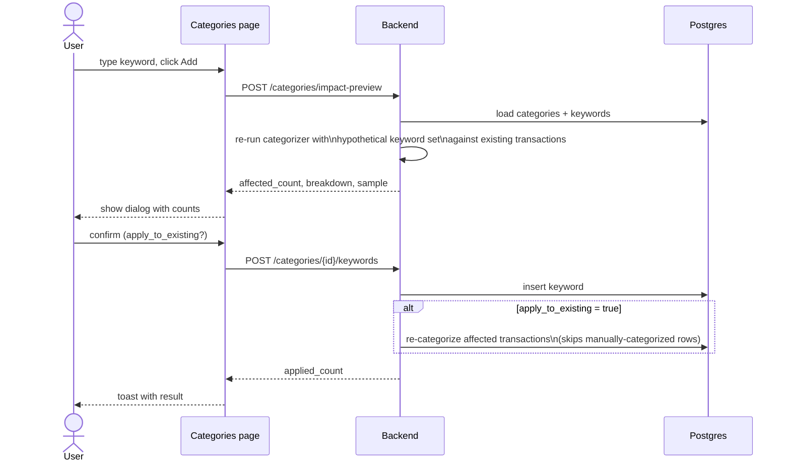

# ledgerline

A self-hosted personal finance dashboard that turns raw bank/card CSV exports into
a categorized, de-duplicated transaction ledger. Upload statements from five
different institutions, let keyword rules sort them into editable categories, and
browse the result through an analytics dashboard — all running locally via
`docker compose up`, with nothing sent to a third party.

## Table of contents

- [Getting started](#getting-started)
- [Architecture](#architecture)
- [Data flow: upload to ledger](#data-flow-upload-to-ledger)
- [Keyword edit flow](#keyword-edit-flow)
- [Idempotency](#idempotency)
- [Supported bank formats](#supported-bank-formats)
- [Testing](#testing)
- [Troubleshooting](#troubleshooting)

## Getting started

**Prerequisites:** Docker and Docker Compose.

```bash
cp .env.example .env
docker compose up
```

That builds and starts all three services:

| Service  | URL                                          | Notes                           |
|----------|-----------------------------------------------|----------------------------------|
| Frontend | http://localhost:5174                        | React dashboard (ledgerline)    |
| Backend  | http://localhost:58000/api/v1                | REST API                        |
| Swagger  | http://localhost:58000/docs                  | Interactive API docs            |
| Postgres | localhost:55432                              | For a local DB client            |

On first boot the backend runs `alembic upgrade head` then `python -m app.seed`
(idempotent — safe to re-run), seeding institutions and the default category/keyword
set before starting uvicorn.

**Changing ports:** host ports are mapped non-default (`55432`, `58000`, `5174`) so
they're unlikely to collide with other local services. Edit `POSTGRES_PORT`,
`BACKEND_PORT`, or `FRONTEND_PORT` in `.env` and re-run `docker compose up` — the
frontend's dev server proxies `/api` to the backend container directly, so no CORS
configuration is needed regardless of which host port you expose it on.

## Architecture

Three services, one `.env`, no external dependencies:



The frontend's Vite dev server proxies `/api` straight to the backend container by
service name (`backend:8000`), so the browser never needs direct network access to
the backend port and there's no CORS setup. The backend is the only service that
talks to Postgres.

## Data flow: upload to ledger

Uploading a CSV walks through detection, per-row parsing with fault isolation,
normalization, hashing for idempotency, categorization, and a single-transaction
insert:



The whole batch — every row insert, account creation, and the batch record itself —
runs in one database transaction. Any unexpected DB error propagates and the batch
is marked `failed` instead of being silently swallowed (a bug in the old parser this
rebuild specifically fixes).

## Keyword edit flow

Adding, removing, or renaming a category keyword always previews its blast radius
before applying:



Manually-categorized transactions (`category_source = manual`) are sticky — a
keyword add/remove never moves them, even with "apply to existing" checked.

## Idempotency

Re-uploading the same statement — or an overlapping export that repeats some rows —
must never create duplicate transactions, but two *genuinely different* purchases
that happen to look identical (same date, amount, description) must both survive.

- **`content_hash`** = `sha256(institution | account_hint | date_iso | signed_amount |
  normalized_description)`. Deliberately excludes `posted_date` and the filename, so
  a re-export covering an overlapping date range still dedupes against what's
  already stored.
- **`occurrence_index`**: within one parsed file, rows that hash identically are
  numbered `0, 1, 2, …` in file order. The unique constraint is on
  `(content_hash, occurrence_index)` together, not `content_hash` alone.
- **The legit-duplicate case**: two identical $5 coffee purchases on the same card,
  same day, read as two rows with the same `content_hash` but `occurrence_index` 0
  and 1 — both insert. Re-uploading the same file reproduces the same two rows with
  the same two indices, so both now collide with existing rows and both dedupe as
  duplicates, not as one duplicate and one new insert.
- Inserts use `INSERT ... ON CONFLICT (content_hash, occurrence_index) DO NOTHING
  RETURNING id`; a row that doesn't come back from `RETURNING` is counted as a
  duplicate, not an error.

This replaces the old project's O(n·m) in-memory dedup pass, which conflated the
"same row twice" case with the "two legitimately identical transactions" case.

## Supported bank formats

| Institution | File pattern | Date format | Amount convention | Quirks |
|---|---|---|---|---|
| American Express | `*.csv` | MM/DD/YYYY | Single signed `Amount`, **positive = charge** (inverted internally) | `Account #` is last-5 with a literal leading minus (`-21003`); descriptions may be fixed-width padded |
| Capital One | `*.csv` | YYYY-MM-DD | Unsigned `Debit`/`Credit` columns | Header is **identical to Discover** — filename substring breaks the tie, else 409 |
| Discover | `*.csv` | YYYY-MM-DD | Unsigned `Debit`/`Credit` columns | Same header as Capital One; descriptions may contain quoted commas |
| Citi | `*.CSV` (**uppercase** extension) | MM/DD/YYYY | `$ 27.95` debit, ` -$ 345.33` credit (sign before `$`) | Extension check is case-insensitive; no account column (fixed hint `citi`) |
| Schwab (checking) | `*.csv` | MM/DD/YYYY | `Withdrawal`/`Deposit` columns, thousands-comma amounts (`$4,130.32`) | All fields quoted; extra `Type`/`CheckNumber`/`RunningBalance` columns ignored; carries the payment side of card statements |

Internal convention everywhere past the parser boundary: **negative = money out,
positive = money in**.

## Testing

**Backend** (from `backend/`, with the virtualenv activated or via `.venv/bin/`):

```bash
.venv/bin/python -m pytest tests -q
```

Covers per-parser unit tests against both crafted fixtures and the 5 real sample
files (exact row counts), malformed-row isolation, hashing/occurrence-index
stability, categorizer precedence, and the full API surface (upload → re-upload
idempotency, 409 ambiguity flow, impact-preview counts, manual stickiness).

**Frontend E2E** (from `frontend/`, against the already-running `docker compose`
stack):

```bash
npm run e2e          # playwright test
npm run e2e:report   # opens the last HTML report
```

The HTML report lands in `frontend/playwright-report/` (and raw results in
`frontend/test-results/`). Playwright is configured to use the system Chromium
binary rather than a managed download — see `frontend/playwright.config.ts`.

## Troubleshooting

**Port already in use.** Change the relevant `*_PORT` variable in `.env` and
re-run `docker compose up` — nothing else needs to change, since the frontend
proxies to the backend by Docker service name, not by host port.

**"Which bank is this?" picker keeps appearing.** Capital One and Discover ship
identical CSV headers. The registry tries to break the tie using the filename
(`capital`/`cap_one`/`capitalone` vs. `discover`); rename the file to include one of
those substrings to skip the picker, or just answer it once per upload.

**Reset the database.** The Postgres data lives in a named volume:

```bash
docker compose down
docker volume rm transaction-parser_db-data   # check `docker volume ls` for the exact name
docker compose up
```

This drops all transactions, categories, and uploads; the seed script repopulates
institutions and the default category/keyword set on the next backend startup.

**Re-running the seed manually** (categories/institutions only — never touches
transactions):

```bash
docker compose exec backend python -m app.seed
```

**Viewing logs:**

```bash
docker compose logs -f backend
docker compose logs -f frontend
docker compose logs -f db
```
