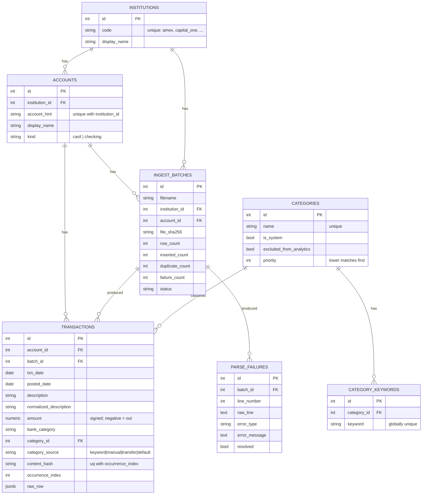

# backend

FastAPI + SQLAlchemy 2.0 service that parses bank CSV exports, deduplicates and
categorizes the rows, and serves the REST API behind the dashboard.

- **Stack:** Python 3.14, FastAPI, SQLAlchemy 2.0 (typed ORM, no legacy Query API),
  Pydantic v2 (schemas with `from_attributes` + `json_schema_extra` examples),
  Alembic migrations, Postgres 16, pytest.
- **Entry point:** `app/main.py`. On container start, `alembic upgrade head` runs
  first, then `python -m app.seed` (idempotent — upserts institutions and the
  default category/keyword set without touching existing transactions), then
  uvicorn.

## Module map

```
app/
├── main.py            FastAPI app, router wiring, /health
├── config.py          pydantic-settings, reads DATABASE_URL etc. from env
├── db.py              SQLAlchemy engine/session, declarative Base
├── seed.py            idempotent institution + category/keyword seed
├── models/            SQLAlchemy mapped classes (one file per table group)
│   ├── institution.py
│   ├── account.py
│   ├── category.py    Category + CategoryKeyword
│   ├── transaction.py
│   └── ingest.py       IngestBatch + ParseFailure
├── schemas/           Pydantic v2 request/response models, by resource
├── domain/            frozen dataclasses: RawRow, ParsedTransaction, RowFailure
│                      (the parser layer's pure in/out types — no ORM, no DB)
├── parsers/           one module per bank + shared machinery
│   ├── base.py         BaseParser ABC, parse_money/parse_date/normalize_description
│   ├── amex.py, citi.py, schwab.py
│   ├── _capone_discover_base.py   shared base (identical CapOne/Discover header)
│   ├── capital_one.py, discover.py
│   └── registry.py     header/filename detection, institution_code -> parser lookup
├── services/
│   ├── hashing.py          content_hash + occurrence_index assignment
│   ├── categorizer.py      transfer-first / priority+length keyword engine
│   ├── category_service.py CRUD, keyword add/remove, impact-preview dry-run
│   ├── ingest_service.py   orchestrates parse -> hash -> categorize -> insert
│   └── analytics_service.py timeseries / distribution / summary queries
└── api/               one router per resource: uploads, transactions, categories,
                        failures, analytics, accounts
```

## Schema (ERD)



Indexes: `transactions(txn_date)`, `transactions(category_id)`,
`transactions(account_id)`, plus the idempotency unique constraint
`(content_hash, occurrence_index)`.

## Categorization precedence

Applied in `app/services/categorizer.py`, built fresh once per ingest batch (or
once per impact-preview call, against a hypothetical keyword set):

1. **Transfer rule first.** Every keyword belonging to the system category
   `Payments & Transfers` is checked before anything else, regardless of
   `priority`. This is what catches both sides of the same real-world transfer —
   the card-side credit ("AUTOPAY ... THANK YOU") and the checking-side debit
   ("CITI CARD ONLINE PAYMENT") — and routes both into the analytics-excluded
   transfer bucket.
2. **General keyword scan.** Every other category, ordered by `priority` ascending,
   then by keyword length descending within a category (so a longer, more
   specific keyword — e.g. `"WHOLE FOODS MARKET"` — wins over a shorter substring
   of it in the same pass). First substring match on `normalized_description`
   (uppercased, whitespace-collapsed) wins.
3. **Fallback.** Anything matching nothing lands in the system `Uncategorized`
   category.

Manual recategorization (`PATCH /transactions/{id}`) sets `category_source =
"manual"`, which makes that row sticky: a later keyword add/remove impact-preview
excludes manually-categorized rows from re-apply, even with `apply_to_existing`
checked.

## Adding a bank parser

1. Create `app/parsers/<bank>.py`, subclassing `BaseParser`:
   - Set `institution_code` (short, lowercase, matches the seeded `institutions`
     row you'll add) and `account_kind` (`"card"` or `"checking"`).
   - Declare `expected_header` as the exact tuple of column names the bank's CSV
     ships with the header matcher (`BaseParser.matches_header`) uses an exact
     ordered match.
   - Implement `parse_row(cls, row: dict[str, str], line_no: int) ->
     ParsedTransaction`, using the shared `parse_money` / `parse_date` /
     `normalize_description` helpers from `base.py`. Raise `ValueError` (or let a
     helper raise it) on anything unparseable — the per-row try/except in
     `BaseParser.parse()` turns that into a `RowFailure` without aborting the rest
     of the file.
   - Apply the bank's own sign convention so the result follows the project-wide
     rule: negative = money out, positive = money in.
2. Register it in `app/parsers/registry.py` — add it to the `_PARSERS` tuple. If
   its header could collide with an existing parser's (like CapOne/Discover),
   add a filename-hint tiebreak following the existing pattern, or accept that
   it'll surface the 409 `AMBIGUOUS_INSTITUTION` picker.
3. Seed the institution: add a row to the institutions table in `app/seed.py` with
   a matching `code`.
4. Add a fixture CSV under `tests/fixtures/csv/<bank>_happy.csv` (few representative
   rows) and `tests/fixtures/csv/<bank>_malformed.csv` (one bad row to prove
   isolation).
5. Write `tests/unit/test_<bank>_parser.py` covering: correct row count, sign
   convention, account hint extraction, and the malformed-row case producing a
   `RowFailure` with the right line number. If a real sample file exists under
   `transactions/`, add it to `tests/unit/test_real_files.py` with its exact
   expected row count.
6. Run `pytest tests -q` — all existing tests plus the new ones should pass.

## API

Full interactive documentation — including request/response examples for every
schema — is served at **http://localhost:58000/docs** (Swagger UI) once the stack
is running. Summary:

| Router | Base path | Key endpoints |
|---|---|---|
| Uploads | `/api/v1/uploads` | `POST` (multipart + optional `institution`), `GET` list, `GET /{id}` detail with failures |
| Transactions | `/api/v1/transactions` | `GET` (date range, accounts, categories, search, `include_excluded`, sort, pagination), `PATCH /{id}` recategorize |
| Categories | `/api/v1/categories` | CRUD; `POST /impact-preview`; `POST /{id}/keywords`, `DELETE /{id}/keywords/{kw_id}` |
| Failures | `/api/v1/failures` | `GET` (optional `resolved` filter), `PATCH /{id}` |
| Analytics | `/api/v1/analytics` | `GET /summary`, `GET /timeseries`, `GET /distribution` — all honor `include_excluded=false` by default |
| Accounts | `/api/v1/accounts` | `GET` list, `PATCH /{id}` rename |
| Health | `/health` | liveness check used by the compose healthcheck |

## Tests

```bash
.venv/bin/python -m pytest tests -q          # everything
.venv/bin/python -m pytest tests/unit -q     # parsers, hashing, categorizer, registry
.venv/bin/python -m pytest tests/api -q      # upload flow, 409 ambiguity, impact-preview, stickiness
```

`tests/conftest.py` and `tests/api/conftest.py` set up an isolated test database
per run; fixtures live under `tests/fixtures/csv/`.
